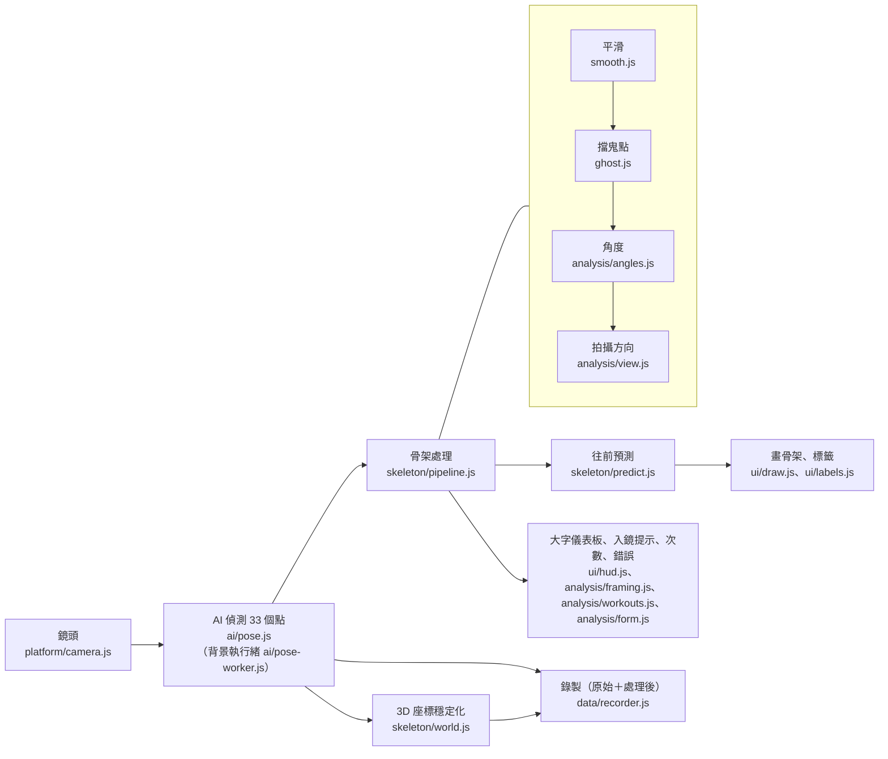

# 程式架構

這份文件說明整個網站的程式怎麼分工：每個資料夾負責什麼、鏡頭的一格畫面會經過哪些程式，以及怎麼測試。第一次看程式碼，建議先讀這份。

## 一、設計原則

1. **影像不離開裝置**：AI 在使用者自己的手機或電腦上執行，鏡頭影像不會上傳。錄製的只有關鍵點座標，而且只會存成使用者自己下載的檔案。雲端（Firebase）只在使用者打開「雲端同步」時存運動總結的數字（`js/cloud/`）。
2. **不需要安裝、不需要編譯**：純 HTML、CSS、JavaScript（ES 模組），直接放在 GitHub Pages 上就能用。沒有打包工具，原始碼就是實際執行的程式。
3. **一個檔案只做一件事**：例如 `smooth.js` 只負責平滑、`angles.js` 只負責算角度。要改某個功能時，只需要看一個檔案。
4. **畫面與計算分開**：計算的程式（`skeleton/`、`analysis/`、`data/`）不碰畫面，可以直接拿來測試，鏡頭頁和重播頁也共用同一份。
5. **原始資料永遠保留**：平滑、擋鬼點都只影響畫面上畫的東西；錄製檔同時存原始資料和處理後的資料，之後換方法時不用重錄。
6. **註解寫原因**：每個檔案開頭說明它的用途，數字門檻旁邊寫「為什麼是這個數字」，以及是用什麼測試、模擬決定的。

## 二、資料夾

```
claude-workspace/
├── index.html          首頁＋鏡頭畫面
├── replay.html         錄製資料重播分析
├── report.html         實測報表（重播分析底下：一次讀很多個實測檔，比對每一組）
├── protractor.html     照片量角器（使用說明「驗證實驗 A」的另一種量法：在照片上拖三個點量角度，和 AI 比）
├── help.html           使用說明
├── results.html        研究成果（使用說明底下：目前量到的數字整理成一頁，報告時打開；10/28）
├── sw.js               離線功能（Service Worker；瀏覽器規定要放在網站最外層）
├── manifest.webmanifest  加到手機主畫面（10/29）：名稱、圖示、從主畫面打開沒有網址列、長按圖示的四個動作捷徑
├── icons/              主畫面圖示（192、512、Android 裁切用的 maskable 512、iPhone 的 180）
├── firestore.rules     雲端資料庫的安全規則（貼到 Firebase 主控台；docs/firebase-setup.md）
├── firebase.json       Firebase 本機模擬器的設定（開發、測試用）
├── css/
│   ├── style.css       全站共用的樣式（三頁共用的導覽列、首頁、鏡頭畫面、使用說明）
│   └── replay.css      重播分析頁專用的樣式
├── js/
│   ├── config.js       全站設定：MediaPipe 版本、模型位置、網址參數
│   ├── pages/          每一頁的主程式：把下面的模組組合起來、處理按鈕
│   ├── ai/             AI 模型：載入 MediaPipe、在背景執行緒偵測骨架
│   ├── skeleton/       骨架處理：平滑、擋鬼點、往前預測、3D 座標穩定化
│   ├── analysis/       動作判斷：關節角度、拍攝方向、入鏡提示、深蹲次數
│   ├── ui/             畫面元件：骨架、標籤、大字儀表板、數據表、曲線圖
│   ├── platform/       裝置功能：鏡頭、螢幕保持亮著、離線、GPU、裝置支援檢查
│   ├── cloud/          雲端同步（Firebase）：網站只透過這裡用雲端，之後換成自己的伺服器只改這裡
│   └── data/           錄製與重播：匯出 CSV／JSON、讀檔重算、合成示範資料
├── tools/              命令列工具（開發用，11/2 起）：dataset.mjs 實測檔 → AI 模型的資料（CSV）、split.mjs 訓練和測試照受測者分、
│                       train.mjs 訓練 AI 模型（Random Forest）並和規則、DTW 比（--test 一種分法、--cv 交叉驗證、--module 存成網站用的模型）、
│                       evaluate.mjs 三種判斷法各猜對幾下、train-activity.mjs 訓練「AI 自動辨識動作」的模型（11/8）
├── tests/              自動測試（node --test tests/）
├── docs/               文件（這份、資料格式、設計規劃、日後改進）
└── .github/workflows/  自動化：發布網站、每次推送時跑測試
```

### 每個檔案

| 資料夾 | 檔案 | 負責 |
|---|---|---|
| `pages/` | `main.js` | 鏡頭頁：開關鏡頭、每一格的流程、工具列、數據面板、開始和停止錄製（和實測模式的一組接在一起）；首頁的卡片各自在 `ui/`（`start-pick.js`、`goal-pick.js`、`voice-pick.js`、`cloud-panel.js`、`test-card.js`）；錄製前倒數、錄製上限、錄製檔清單也在 `ui/`（10/25 搬出去：`rec-countdown.js`、`rec-limit.js`、`library-panel.js`）；即時 AI 判斷（11/7）：每一下的提示多一行 AI 判斷、運動總結多一句（`ai-judge.js` 的 `judgeRep`、`aiLine`，和重播分析同一個寫法）；AI 自動辨識動作（11/8）：自由模式時上方卡片寫 AI 猜的動作、「切換到深蹲」一鍵選動作（`activity.js`）；手勢控制（11/8）：舉一隻手過頭 2 秒和錄影控制列的大圓鈕一樣（開始、取消倒數、結束），倒數寫在上方（`gesture.js`；首頁的開關會記住，實測模式不用）；AI 全自動（11/9）：首頁開關打開時，選了動作也一直猜，認出另一個動作就自動換過去，最近幾秒的骨架交給新的動作重算（`auto-mode.js`；錄製中不換、實測模式不用） |
| | `replay.js` | 重播分析頁：選檔、曲線圖、統計、動作分析（每一下的圖表、疲勞分析、流暢度、穩定度和首頁總結同一套；棒式錄製開始、停止時還在撐會寫出來）、3D 檢查、匯出角度 CSV；每一下的「AI 判斷（把握）」和規則並排（11/4，`ai-judge.js`）；AI 自動辨識動作（11/8）：這段錄影 AI 猜了什麼、各幾秒，和分析的動作不一樣時「用深蹲分析」一鍵改（`activity.js`） |
| | `report.js` | 實測報表頁（10/21）：選很多個實測檔、zip 或這支手機裡的錄製檔，一個一個重算，列出每一組和整體統計、下載 CSV；「AI 模型的資料」（11/2）：同一批檔案的每一下一列，寫幾列、每種標記幾下，下載 CSV；AI 模型和規則各猜對幾列（11/4，訓練時看過的受測者不算） |
| | `protractor.js` | 照片量角器頁（10/22）：選照片、AI 找關節（和鏡頭畫面同一個 AI、同一套角度算法）、拖三個圈量角度、記下來（驗證實驗 A 的清單） |
| | `help.js` | 使用說明頁：「檢查這支手機」 |
| | `hero-art.js` | 首頁的深蹲動畫 |
| | `exercise-demos.js` | 四個動作的示範動畫放到首頁「支援的運動」卡片和鏡頭畫面的「示範」視窗 |
| `ai/` | `pose.js` | 載入 MediaPipe 與模型（兩個下載來源、逾時重試）、選 GPU 或 CPU、背景執行緒當掉時自動重啟 |
| | `pose-worker.js` | 背景執行緒：在這裡跑 AI，主畫面不會卡 |
| | `fps.js` | 計算每秒偵測幾格 |
| | `model-choice.js` | AI 模型的選擇：lite、full 或自動（先用 full，這台裝置跟不上就改用 lite 並記住） |
| | `advisor.js` | 速度建議：量 AI 每格幾毫秒、每秒幾格，建議要不要換每秒格數或模型（只建議，不自動改） |
| `skeleton/` | `pipeline.js` | 處理流程的總管：每一格依序呼叫平滑 → 擋鬼點 → 角度 → 拍攝方向 |
| | `landmarks.js` | 33 個關鍵點的名稱、哪些是主要關節、看不看得到 |
| | `smooth.js` | One Euro Filter 平滑：靜止時不抖、動作快時跟得上 |
| | `ghost.js` | 擋掉 AI 腦補出來的點與「人走了還留著」的鬼骨架 |
| | `predict.js` | 往前預測：補償 AI 計算的時間，骨架不會拖在身體後面 |
| | `world.js` | 3D 座標穩定化：平滑＋骨頭長度限制 |
| `analysis/` | `angles.js` | 關節角度（膝、髖、肘），肢體太短時不給角度 |
| | `view.js` | 判斷側面、斜側面、正面拍，以及面向哪一邊 |
| | `framing.js` | 入鏡提示（請往後退、請站到中間…），不會一直閃 |
| | `light.js` | 光線偵測：畫面平均亮度，太暗時提醒 |
| | `form.js` | 動作錯誤判斷：每個動作常見的錯誤（上身前傾、塌腰…），要標紅的部位 |
| | `session.js` | 運動總結：一次運動做了幾下、品質、錯誤統計，和上一次同一個動作比較；紀錄存在這台裝置上；AI 全自動做了哪幾段的那一句（`shortLine`、`autoList`：6 段以內照順序，超過每種加起來，首頁和重播分析共用） |
| | `tracker.js` | 一次運動的計算：次數（計時）＋錯誤，並把做每一下期間的錯誤記到那一下；鏡頭畫面和重播分析共用；AI 全自動換動作時拿掉新的動作會重算的那幾下（`dropFrom`，11/8 保養） |
| | `ai-judge.js` | AI 判斷（11/4）：網站裡的 AI 模型猜每一下是做對還是哪一種錯（`aiJudge`）、規則的判斷換成同一個說法（`ruleJudge`，`tools/evaluate.mjs` 也用）、判斷的中文、這位受測者訓練時看過沒（看過的不算準確率）；模型檔被改壞的動作就不判斷。11/7：一下、一組的 AI 和規則判斷（`judgeRep`、`judgeReps`）、表格和提示的寫法（`judgeCell`）、那一句（`aiLine`）：重播分析、首頁運動中的提示和運動總結共用，數字才會一樣。11/10：AI 動作評分（`repScore`：每一下 0～100 分 = AI 覺得做對的把握 × 相似度，棒式只看把握；`scoreLine`：平均、最好、最差的一下；`scoreAverage`：平均幾分，11/8 AI 全自動換動作時講），三個地方同一個算法。11/11：AI 解釋（`aiLimit`：這一下其他數字不動，一種錯誤的數字加到多少 AI 改判成那種錯，只試森林分岔門檻旁邊那一格，和一格一格試的一樣；`explainRep`：這一下為什麼這樣判；`explainLine`：分數最差的那一下），首頁總結和重播分析同一句 |
| | `ai-model.js` | 網站用的 AI 模型（11/4，**自動產生，不要手改**：`node tools/train.mjs --synthetic A,B,C,D,E,F,G,H --cv --module js/analysis/ai-model.js`；真人的實測檔來了換成 `node tools/train.mjs 實測檔資料夾 --cv --module js/analysis/ai-model.js`）。現在是合成資料訓練的示範模型（約 79 KB，壓縮後約 8 KB）；`tests/ai-judge.test.mjs` 會重新訓練一次比對，改了特徵或合成資料卻沒重新產生會失敗 |
| | `activity.js` | AI 自動辨識動作（11/8）：最近 3 秒的骨架 → 特徵（身體斜幾度、膝／髖／手肘角度和變化、左右差、髖部和肩膀上下移動、兩腳前後分開；`frameValues`、`windowFeatures`）→ 模型猜站著、深蹲、伏地挺身、棒式、弓箭步；`ActivityMeter` 每 0.5 秒猜一次（首頁自由模式、重播分析、訓練都用同一個取法）、`ActivityDisplay` 畫面上連續 2 次才換、把握不到 6 成寫還不確定、`activitySummary` 一段錄影各猜了幾秒 |
| | `activity-model.js` | AI 自動辨識動作的模型（11/8，**自動產生，不要手改**：`node tools/train-activity.mjs --synthetic A,B,C,D,E,F,G,H --test I,J,K --module js/analysis/activity-model.js`）。合成的火柴人訓練的示範；`tests/activity.test.mjs` 會重新訓練一次比對 |
| | `gesture.js` | 手勢控制（11/8）：這一格是不是站著舉一隻手過頭（手腕比鼻子高出身體長度的 1/4、另一隻手在肩膀下面；兩手都舉、趴著不算）；舉滿 2 秒觸發一次，手放下才會再觸發，AI 漏掉一兩格不算放下 |
| | `auto-mode.js` | AI 全自動（11/9）：什麼時候自動換動作（畫面上 AI 猜的動作穩定 1.5 秒；已經在數別的動作 3 秒；站著、還不確定、錄製中不換）、留最近 8 秒的骨架、換過去時從哪一格開始重算（這個動作大概開始的時候）、原本的動作拿掉新的動作會重算到的那幾下（`dropRecounted`，11/8 保養：AI 還沒認出換了動作的那幾秒原本的動作照樣在數，同一下不能兩個動作都算；新的動作重算時一下都沒數到、換成棒式時不拿）。合成受測者試過：從自由模式開始每一下都數到 |
| | `auto-segments.js` | 重播分析的 AI 全自動分段（11/8 追加 3）：自由模式錄的影片（或檔案沒記動作的）做了好幾個動作，照首頁 AI 全自動的做法一格一格跑（AutoSwitch 決定什麼時候換、從哪一格重算，換的時候 `dropRecounted`），切成幾段、每一段用 AI 認出的動作數；自己一套 ActivityMeter，不動重播分析原本「AI 猜了什麼、各幾秒」的統計；選了動作錄的檔案不分段 |
| | `forest.js` | AI 模型（11/3）：Random Forest（很多棵決策樹投票）的訓練和預測，不用套件；看不到的數字當成一種情況；同樣的 seed 長出一樣的森林；一個動作一個模型（特徵照 `features.js`、標記做對在前面），存成 JSON；模型最常看哪幾個數字（`featureUse`）；一般的分類模型（`trainClassifier`，11/8 AI 自動辨識動作用） |
| | `features.js` | AI 模型的特徵（11/2）：每一下每條錯誤規則量到的數字「持續 0.4 秒的最大值」（`tracker.js` 記到 `rep.features`；超過門檻就是規則會報的錯，棒式只看第一次到最後一次一直線之間），每個動作放進資料表的欄位（棒式不放撐了幾秒、不放第幾下：實測規定的秒數、下數會洩漏答案） |
| | `balance.js` | 平衡與重心（10/24）：身體各部位照重量比例算 2D 重心、重心比腳踝往前多少（小腿長為 100%）、站直時前後晃動多少；自由模式、深蹲，側面拍才算；鏡頭畫面和重播分析共用 |
| | `similarity.js` | 動作相似度：每一下的角度曲線和示範動作用 DTW 對齊比對，給 0～100 分 |
| | `rep-series.js` | 「每一下」圖表的數字（10/27）：每一下的最低角度、深度、秒數、錯誤（棒式：每一次的秒數），和總結同一套算法（角度四捨五入、秒數到小數第 1 位、棒式無條件捨去）、相似度；首頁總結和重播分析共用 |
| | `fatigue.js` | 疲勞分析（10/28）：同一組的前三分之一和後三分之一比（6 下以上才比）：變慢（秒數 1.5 倍）、變淺（最低角度大 15°）、錯誤變多、相似度掉 12 分；門檻是 10/20 實測正常做的組自然差別的 1.5 倍；中途休息（兩下之間 30 秒以上）前後分開、只比最長的一段，中途停住（一下超過 10 秒）不算進秒數。`FatigueWatch`：運動中越來越淺時提醒一次（休息後重新算） |
| | `growth.js` | 成長曲線（11/1）：這台裝置和雲端的紀錄合起來（同一筆只算一次）、一天一個點（一次最多幾下取那天最好的一組，比例把那天的下數加起來算，和總結同一個算法）、最多最近 30 天、那一句話 |
| | `stability.js` | 動作穩定度（10/30）：深蹲、弓箭步每一下重心前後晃動（重心比腳踝往前多少的標準差，小腿長 100%，用 `balance.js` 的重心），棒式撐著時髖部上下晃動（身體彎幾度，每 2 秒算一次再平均，慢慢塌下去不算），6 下以上（棒式 12 秒以上）比前段、後段；只顯示數字，門檻等實測資料。`WorkoutTracker` 每一格記、做完一下算好就清掉 |
| | `coach.js` | 教練建議（10/31）：這組要給教練看的數字（只有數字和動作名稱）、兩三句固定的建議：最常出現的錯誤（用畫面上的紅字）→ 沒蹲到位 → 疲勞 → 節奏忽快忽慢 → 中途卡住；都做得好就說做得好的地方和下一步 |
| | `fluency.js` | 動作流暢度（10/29）：每一下中途有沒有卡住（速度掉到一成以下超過 0.2 秒；深蹲、伏地挺身，弓箭步不看）、整組的節奏穩不穩（和平均差不到 2 成的有 8 成以上）；`WorkoutTracker` 完成一下時從角度曲線算好卡住幾次 |
| | `goal.js` | 自訂目標（10/25）：每個動作的目標（常用的或自己填，存在這台裝置上）、棒式報時（每 10 秒、最後 5 秒倒數、時間到）、計次做到目標的那一句、總結的「目標 10 下：達成」 |
| | `plan.js` | 智慧課表（11/14）：照運動紀錄排一套（固定的規則，不是模型：上次做得不錯多一成、一半以上有錯誤先少做、其他一樣多；沒有紀錄用起步的下數；設了目標的照設的）、弱點提醒（最近 3 次同一種錯誤 2 下以上）、勾選要做哪幾項（存在這台裝置上）、課表進行（`PlanRun`：第幾項、做到了沒、換下一項後準備 6 秒、卡片和語音的字） |
| | `share-text.js` | 分享這次的結果（11/14）：把首頁「這次運動」寫的幾行整理成一段文字（時間、做了哪些動作、總結每一行、AI 評分、教練建議、網址；太長從後面拿掉）。只組文字，送出去在 `ui/share.js` |
| | `calibrate.js` | 個人校正：側身站直不動約 2 秒，記下站直的膝蓋角度和手機傾斜，「站直」門檻和上身前傾的判斷依每個人調整 |
| | `validate.js` | 驗證實驗 A：記下關節角度、和量角器比較的統計（平均誤差、標準差、±5° 以內的比例）、CSV；照片量角器量的也存在這裡（`source: 'photo'`） |
| | `protractor.js` | 照片量角器的計算（10/22）：三個點的角度（2D，和網站一樣）、AI 找到的三個點、存成驗證實驗 A 的一筆（來源寫「照片」） |
| | `reps.js` | 計算次數（伸直 → 彎下去 → 伸直）、計時（姿勢對時計時），四個動作共用；棒式每一次記下最後一格趴著的時間（`lying`，重播看停止錄製時還在不在撐，11/1） |
| | `workouts.js` | 運動模式：自由、深蹲、伏地挺身、棒式、弓箭步各看哪些角度、門檻多少；使用者選的模式 |
| | `squat.js` | 深蹲的門檻與次數（用 `reps.js`） |
| `ui/` | `draw.js` | 在畫布上畫骨架；做錯的部位畫成粗紅線；重心的記號（黃黑相間的圓、往下到腳底的虛線，重播分析也用） |
| | `labels.js` | 關鍵點的編號標籤、點一下看名稱 |
| | `hud.js` | 站遠也看得到的大字儀表板：左、右兩組照鏡子的方式放在畫面左右兩邊，被擋住的那一組變淡 |
| | `pose-compare.js` | 你這一下 vs 標準動作（11/12）：你的骨架照示範動畫的大小、方向擺（`userFigure`：面向左邊的翻過來、大腿一樣長、腳踝對齊；照像素算，畫面不是正方形也不會壓扁），和示範動畫的最低點並排畫（`renderCompare`）；首頁的運動總結和重播分析共用 |
| | `demo.js` | 四個動作的示範動畫（側面火柴人＋角度）和重點字；改重點字只要改這裡 |
| | `sound.js` | 提示音：離開畫面「逼逼逼」、站位不對「逼逼」、站好了「叮」，只在狀況改變時響；音量四段（關、小、中、大），錄製倒數也共用。語音提示選「完整」時改成用講的（`FramingSound` 把提示文字交給 main.js 決定要講還是嗶） |
| | `speech-plan.js` | 說話規則（10/20）：一次一句、過時的不講、先講重要的（站位 ＞ 目標的倒數、時間到 ＞ 錯誤 ＞ 次數）、同一種錯誤連續兩下才講（棒式持續 2 秒）、一下做完才講、站位提示唸短句；三種模式（完整、只講錯誤、不講話） |
| | `voice.js` | 講話：用瀏覽器內建的語音發出聲音（音量跟著「音量」按鈕、卡住 15 秒自動清掉）；記住使用者選的語音模式 |
| | `phone-info.js` | 「複製手機資訊」的文字：系統、瀏覽器、螢幕、AI 每格幾毫秒、每秒幾格（實測時記錄各手機的速度） |
| | `copy.js` | 複製文字（不允許直接複製時改成選好的文字框，讓使用者自己長按複製） |
| | `share.js` | 分享一段文字（11/14）：手機用系統的分享選單（`navigator.share`），使用者自己關掉就算了，其他情況改用 `copy.js` 複製 |
| | `rec-bar.js` | 錄影控制列（10/20，像手機相機）：紅色大圓鈕開始／結束、暫停、倒數設定、「錄製檔 N」；只管畫面（錄製在 main.js） |
| | `rec-countdown.js` | 錄製前倒數（10/25 從 main.js 搬出來）：用結束時間算剩幾秒、畫面中間的大數字、每秒唸一個數字（不講話時嗶聲）、最後的「開始」 |
| | `rec-limit.js` | 錄製上限（10/25 從 main.js 搬出來）：5～20 分鐘的選單（會記住）、檔案大約多大、手機錄太久的提醒 |
| | `library-panel.js` | 錄製檔（10/25 從 main.js 搬出來）：首頁那一列（還沒下載的變黃）、鏡頭畫面的清單、每一段停止後存進錄製檔（實測的一組照設定也馬上下載） |
| | `library-list.js` | 錄製檔清單的畫面（首頁、鏡頭畫面共用）：勾選、一段一段下載、勾選的一次下載、壓縮成 zip、刪除 |
| | `test-bar.js` | 實測模式的控制列：鏡頭畫面上「這組要做的」按鈕、倒數和錄製中的狀態、「這組做完」、錄過的組打勾（錄製、下載在 main.js） |
| | `infobar-space.js` | 鏡頭畫面左上角的狀態列換行變高時（小手機、點開運算標籤、光線提醒），把下面置中的大字（入鏡提示、紅字、每一下的提示）往下推，不被蓋住 |
| | `start-pick.js` | 首頁「今天要做什麼運動？」：四個大按鈕按了就開鏡頭；`#startBtn`（用目前選的動作開鏡頭）跟著選的動作換位置和字 |
| | `cloud-ask.js` | 第一次有運動總結時問一次要不要打開雲端同步（選過就不再問） |
| | `cloud-panel.js` | 首頁的雲端同步卡片（開關、狀態、刪除雲端上的紀錄）和運動完的詢問；10/22 從 main.js 搬出來 |
| | `voice-pick.js` | 首頁「語音提示」三選一（完整、只講錯誤、不講話）；10/22 從 main.js 搬出來 |
| | `rep-chart.js` | 「每一下」的圖表（10/27）：每一下多深（顏色＝到位／再低一點／太淺）、每一下幾秒（平均線）、棒式每一次撐幾秒（目標線），下面有「每一下的數字」表格（重播分析不畫：那裡本來就有更詳細的表格）；下數很多時長條緊貼、不互相疊到，中途停住的那一下不拿來定縱軸；畫成 SVG，字照實際像素；首頁總結和重播分析共用 |
| | `fatigue-view.js` | 疲勞分析的顯示（10/28）：首頁「這次運動」寫一句＋每一項「前段 → 後段（差多少）」，超過門檻的寫「可能累了」 |
| | `growth-chart.js` | 首頁的「成長曲線」（11/1）：選動作、選數字、一條線（一天一個點）、「每一天的數字」表格；雲端同步打開時，打開這一塊才讀雲端上的紀錄，讀不到先畫這台裝置的、寫出原因 |
| | `coach-view.js` | 教練建議的顯示（10/31）：首頁「AI 教練」開關、總結最上面的「教練建議」（固定句子，AI 教練打開時換成 Gemini 寫的；失敗時寫出原因），唸出來交給 main.js；`quiet`（11/9 保養）：AI 全自動換動作時只寫固定句子，不唸、不問 Gemini |
| | `goal-pick.js` | 首頁「目標」卡片（10/25）：四個動作各一列，選常用的目標或自己填（填錯說明範圍、不存） |
| | `plan-card.js` | 首頁「智慧課表」卡片（11/14）：一行這次排的、「開始課表」；點開看每一項的理由、勾選要做哪幾項（至少一項，會記住）；紀錄或目標變了重排；不能開鏡頭、實測模式開著時不能按（寫原因） |
| | `test-card.js` | 首頁「實測模式」卡片：開關、受測者代號、每組做完要不要馬上下載、開著時的黃色提醒；10/22 從 main.js 搬出來 |
| | `task-card.js` | 使用說明的實測任務卡：做完的項目打勾，存在這台裝置上 |
| | `datapanel.js` | 數據面板的數值表格 |
| | `chart.js` | 重播頁的角度曲線圖 |
| `platform/` | `camera.js` | 開關鏡頭、列出鏡頭、判斷前後鏡頭 |
| `platform/` | `video-source.js` | 示範模式（10/26）：選一段影片，在看不到的 `<video>` 播、用 `captureStream()` 變成和鏡頭一樣的串流，交給 main.js 原本的鏡頭流程 |
| | `screen.js` | 運動時讓螢幕保持亮著（Wake Lock） |
| | `offline.js` | 註冊離線功能（`sw.js`），`?sw=0` 可移除 |
| | `install.js` | 加到手機主畫面（10/29）：瀏覽器發 `beforeinstallprompt` 時首頁頁尾才出現「加到主畫面」，按了跳出安裝視窗；已經從主畫面打開（standalone）不出現；iPhone 看使用說明 |
| | `gpu.js` | 查詢 GPU 名稱 |
| | `support.js` | 這支手機能不能用（WebGL2、相機、系統版本） |
| `cloud/` | `config.js` | Firebase 專案的設定（還沒貼時雲端同步不出現）、Firebase 程式的版本、本機模擬器 |
| | `sync.js` | 上傳哪些欄位（白名單）、每一筆的代號、哪幾筆還沒上傳；和 `firestore.rules` 同一套條件；雲端讀回來的一筆用同一套條件再檢查（`fromCloud`，11/1 成長曲線） |
| | `cloud.js` | 載入 Firebase、匿名登入、上傳和補傳、讀回自己的紀錄（`loadRecords`，11/1 成長曲線用）、刪除雲端的紀錄、給畫面看的狀態；網站其他地方只用這個檔案 |
| | `ai-coach.js` | AI 教練（10/31）：經過 Firebase AI Logic 的 Gemini Developer API，把這組的數字給 Gemini 寫兩三句建議（預設關閉）；10 秒逾時；回答先整理（列點、粗體、表情符號拿掉，補句號），再檢查能不能用（英文、簡體字、網址、太短太長、這組沒有的數字）；沒有網路（不送）、主控台還沒開 AI Logic、逾時、太忙（429）、模型要更新（404）、回答不能用時給原因，畫面改用固定句子（docs/firebase-setup.md 第五節） |
| `data/` | `recorder.js` | 錄製：每一格的原始與處理後資料，匯出 CSV、JSON；上限可選 5～20 分鐘；時間存到 0.01 毫秒（11/1 起，重播才會和運動時一模一樣） |
| | `test-mode.js` | 實測模式（10/20）：受測者代號、每個動作可以選的組（做對、故意做哪一種錯）、錄製檔裡的實測資訊（`meta.test`）、檔名 `test_A_squat_heel_…` |
| | `library.js` | 錄製檔清單（10/20）：每一段停止後存進這支手機（IndexedDB），列清單、讀檔、標已下載、刪除；讀回來的項目先整理（被改過的不用） |
| | `zip.js` | 把好幾個錄製檔壓縮成一個 zip（瀏覽器內建的壓縮；舊瀏覽器只裝在一起不壓縮） |
| | `unzip.js` | 讀 zip（10/21，實測報表用）：錄製檔清單壓的、Windows／Mac 自己壓的都讀得了；每個位置先檢查、內容用 CRC 核對 |
| | `history-csv.js` | 運動紀錄匯出 CSV（10/25）：首頁「運動紀錄」的「下載 CSV」，這台裝置上的全部紀錄，一次運動一列（Excel 打得開；被改過的欄位留空） |
| | `test-report.js` | 實測報表的比對、加總（10/21）：每一組應該做的（`meta.test`）和網站算的、重錄以最後一次為準、報表的順序、整體統計、CSV |
| | `report-core.js`、`report-worker.js` | 實測報表：一個檔案重算（和重播分析同一套算法），只傳回每一下的錯誤和 AI 模型的資料要用的數字（不傳角度曲線）；背景執行緒一次一個檔案 |
| | `dataset.js` | AI 模型的資料（11/2）：一組 → 每一下一列（檔名、受測者、動作、標記＝這組要做的、特徵、規則的判斷另外一欄、是不是合成的）、CSV、摘要；實測報表和 `tools/dataset.mjs` 共用（格式見 data-format.md） |
| | `replay-core.js` | 重播的計算核心：讀檔、用和鏡頭頁相同的流程重算；AI 自動辨識動作每 0.5 秒猜一次、統計各猜了幾秒（11/8） |
| | `replay-worker.js` | 重播的背景執行緒 |
| | `synth.js` | 合成示範資料（3D 火柴人做深蹲），測試與示範用 |

## 三、一格畫面的流程

鏡頭每一格畫面，從拍到畫出來會經過這些程式（`pages/main.js` 負責串起來）：



重點：

- **角度、深蹲判斷、錄製都用沒有預測的數字**，預測只影響畫出來的位置。
- **錄製檔保留 AI 的原始輸出**，處理後的資料另外存一份（欄位在後面），格式見 [data-format.md](data-format.md)。
- **重播分析頁**（`data/replay-core.js`）把錄製檔一格一格丟進**同一個** `skeleton/pipeline.js`，結果和當下鏡頭畫面完全相同，所以可以用錄影檢查判斷得對不對。

## 四、執行緒

| 執行緒 | 做什麼 | 為什麼 |
|---|---|---|
| 主畫面 | 按鈕、畫骨架、平滑與判斷（每格約 1 毫秒） | 要碰畫面的工作只能在這裡 |
| AI 背景執行緒（`ai/pose-worker.js`） | 跑 MediaPipe（每格 20～60 毫秒） | 最重的工作移出去，按鈕、動畫不會卡；不支援的瀏覽器自動改在主畫面跑 |
| 重播背景執行緒（`data/replay-worker.js`） | 讀檔（選的檔案直接交給它讀）、重算整段錄影 | 5 分鐘的檔案在手機上要算好幾秒；20 分鐘的檔案超過 100 MB，在主畫面讀會卡住、記憶體多用一份 |
| Service Worker（`sw.js`） | 存 AI 檔案，第二次打開不用下載、沒網路也能用 | 18 MB 的 AI 檔案每次重新下載太慢 |

## 五、怎麼測試

**自動測試**（不需要瀏覽器、不用安裝套件，約 10 秒）：

```
npm test
```

| 檔案 | 測什麼 |
|---|---|
| `tests/skeleton.test.mjs` | 平滑真的變穩、壞掉的數字不會擴散、亂七八糟的輸入不會當掉；3D 座標穩定化更接近真實位置，而且骨頭長度限制比只做平滑更準 |
| `tests/analysis.test.mjs` | 角度計算、深蹲次數與深度、正面拍不計算、小幅晃動不誤算、入鏡提示（蹲低時腳被擋住不叫人往後退） |
| `tests/data.test.mjs` | CSV／JSON 格式、讀 JSON 和讀 CSV 結果相同、壞掉的檔案給中文錯誤、3D 檢查 |
| `tests/platform.test.mjs` | 從瀏覽器識別字串判斷 iPhone、Android、LINE 內建瀏覽器 |
| `tests/safety.test.mjs` | 外部來的資料（網址、錄製檔、這台裝置存的資料）被改過或損壞：`constructor` 這種內建名字不會被當成動作；壞掉的紀錄、記下的角度整理掉；量角器打錯字不算；CSV 不會被 Excel 當成公式；錄製中不能換動作 |
| `tests/properties.test.mjs` | 數字的規則（固定的亂數，每次一樣）：隨機的速度、每秒格數、漏格，做幾下就算幾下、一格最多加 1；棒式秒數只往上加、不比真的撐住的時間多；相似度快慢不扣分、越淺越低；驗證統計和照定義算的一樣；光線、自動調每秒格數、個人校正的門檻都照規則 |
| `tests/cloud.test.mjs` | 雲端同步：上傳的欄位只有白名單、格式不對的不上傳、和 `firestore.rules` 是同一套條件；把 Firebase 換成假的，測補傳、被拒絕時不當成傳過、逾時、上傳中關掉、同時只跑一個、刪除 |
| `tests/rules/rules.test.mjs` | 雲端的安全規則（要開 Firebase 模擬器，指令見 [firebase-setup.md](firebase-setup.md)）：自己的收、別人的和沒登入的擋、被改過的資料每一種都擋、網站算出來的總結一定收 |
| `tests/live/firebase.mjs` | 真的 Firebase 專案（`npm run test:live`，要有網路，GitHub 上不自動跑）：匿名登入、資料庫、發布的安全規則和專案裡的一樣；測試用的帳號和紀錄測完刪掉 |
| `tests/home.test.mjs` | 首頁：四個大按鈕和自由模式的位置、認不得的動作代號當作自由模式；什麼時候問雲端同步、存不了資料時不會一直問；實測任務卡的勾選被改壞時只留卡片上有的項目 |
| `tests/speech.test.mjs` | 說話規則：一次一句、排隊只留一句、過時的不講、先講重要的、錯誤連續兩下才講、棒式持續 2 秒才講、三種模式；語音模式被改壞時用預設；計次準確率（填的字、怎麼算、記到哪一筆）；複製手機資訊的文字 |
| `tests/why.test.mjs` | 錯誤說出原因：每條規則顯示的數字和判斷一致（2,000 組隨機數字）、句子的寫法、每一下記下最嚴重的數字、總結寫出原因、被改過的紀錄不會出錯 |
| `tests/test-mode.test.mjs` | 實測模式：受測者代號只留英文和數字（名字不會進檔名）、每個動作可以選的組和受測者卡一樣、存的設定被改壞、錄製檔裡的實測資訊被改過就當一般檔案、檔名只有英文數字底線、匯出再讀回來還認得 |
| `tests/report.test.mjs` | 實測報表：每一組的次數、抓到、誤報；重錄以最後一次為準；整體統計；CSV 防公式、加引號；讀 zip（壓縮、不壓縮、中文名、壞掉的跳過）；一個實測檔重算（合成資料） |
| `tests/protractor.test.mjs` | 照片量角器：三個點的角度（直角、一直線、重疊、縮放不變）；AI 的點算出來和網站的角度一樣；看不清楚的點不用；存進驗證實驗 A 的清單（來源、統計、CSV 最後一欄）；被改過的來源 |
| `tests/library.test.mjs` | 錄影：暫停中不錄、已錄時間和錄製上限不算暫停、暫停的地方時間空一段（`meta.pauses`）；錄製檔清單被改過的項目整理掉；zip 的檔名、大小、CRC、解壓縮後一樣 |
| `tests/ui.test.mjs` | 大字儀表板：前鏡頭左側那組在畫面左邊、後鏡頭對調；看不到顯示「—」；被擋住的那一側變淡，門檻附近不會一直閃。提示音：還沒走進畫面不響、離開 1 秒後響且最多提醒 3 次、站位提示換來換去至少隔 2 秒、腳被擋住不響。每秒格數：鏡頭兩次叫醒之間送來幾格都算到。示範動畫：最低點的角度符合重點字、骨頭長度不變、不會穿過地面 |
| `tests/growth.test.mjs` | 成長曲線：一天一個點的每一種數字（和總結的到位比例一樣）、這台裝置＋雲端同一筆只算一次、最多 30 天、那一句話、不認得的動作和數字；雲端讀回來的用上傳的同一套條件檢查 |
| `tests/features.test.mjs` | AI 模型的特徵（11/2）：持續 0.4 秒的最大值（一閃而過的不算、看不到就斷開、照時間不是照格數）、規則不檢查時不量、棒式只看一直線的那段、每個動作的欄位、被改壞的數字；合成的四位受測者每一下每條規則：規則報錯 ⇔ 特徵 > 門檻（504 個） |
| `tests/dataset.test.mjs` | AI 模型的資料（11/2）：一組 → 每一下一列、標記是這組要做的、規則的判斷另外一份；CSV 的欄位、留空、防公式；摘要；合成的實測檔整個流程（重錄的不放、不是實測檔的說原因、順序和實測報表一樣）；命令列工具 |
| `tests/split.test.mjs` | AI 模型的資料檢查（11/2 保養）：照受測者分訓練和測試（同一個人只在一邊、每一列都在）、檢查抓得到同一個受測者或檔案兩邊都有、一邊是空的、測試的標記訓練沒有；合成的三位受測者每次留一位都沒混到、照列隨便分抓得到；特徵裡沒有答案 |
| `tests/synthetic-sets.mjs` | （不是測試，給測試和 `tools/dataset.mjs --synthetic`、`tools/train.mjs --synthetic` 用）合成的實測檔：每位受測者遠近、位置、雜訊、節奏不一樣，本來的樣子也不一樣（上身前傾、腳跟、弓箭步的前膝、伏地挺身的髖部高低，11/3 加；有 10/20 實測根據的寫在註解），故意做錯的程度每一下 0.5～1.6 倍門檻、做對的 0～0.35 倍，用網站的錄製程式存成和真的一樣的 JSON（`meta.test`、`meta.synthetic`）；是火柴人，不是真人。11/8：每一格在做什麼（`activity`：站著或動作的名字，AI 自動辨識動作的標記；只多記一個陣列，亂數不變）、撐著不動的一段（`syntheticHold`：站著、弓箭步的站姿、手撐的棒式） |
| `tests/forest.test.mjs` | AI 模型（11/3）：亂數（同一個起點一樣、起點接近也不相關）、分得開的資料學得會（一個門檻、兩個特徵一起看、三類）、看不到的數字也能拿來分、同樣的 seed 一模一樣、只有一種或沒有資料不會當掉、一個動作的模型（特徵、標記的順序、存成 JSON 再讀回來猜得一樣、被改壞的特徵）、最常看的數字 |
| `tests/ai-judge.test.mjs` | AI 判斷（11/4）：模型檔的格式（四個動作、特徵、標記）；網站裡的模型就是這套程式訓練出來的（重新訓練一次比對）；訓練時沒看過的合成受測者 K 猜得準；被改壞的一下、不認得的動作；規則的判斷換成同一個說法；訓練時看過的受測者；一下和一組的判斷一樣、表格的寫法、那一句（各判成幾下的順序、第幾下用每一下自己的編號、棒式的「次」、對不上時不寫）（11/7） |
| `tests/activity.test.mjs` | AI 自動辨識動作（11/8）：模型檔的格式（五種、特徵）；網站裡的模型就是這套程式訓練出來的（重新訓練一次比對）；訓練時沒看過的合成受測者 K 每一種都猜得準；一格的數字、一段的特徵（資料不夠不猜、被改壞的骨架）；每 0.5 秒猜一次、時間倒退重新開始；畫面上連續 2 次才換、把握不到 6 成寫還不確定；一段錄影的統計，重播分析算的和一格一格猜的一樣 |
| `tests/gesture.test.mjs` | 手勢控制（11/8）：站著舉一隻手才算（兩手、手在胸前、深蹲蹲下去、趴著、看不到臉、擋鬼點標成看不到的、被改壞的都不算；另一隻手看不到當成放著）；舉滿 2 秒觸發一次、一直舉著不再觸發、放下再舉才會、中間放下重來、AI 漏掉兩格接著算、人走掉 1 秒重來、時間倒退 |
| `tests/cv.test.mjs` | 交叉驗證（11/3 保養）：每一位受測者輪流當測試（每一下剛好被猜過一次、訓練裡沒有測試的那位）、同樣的資料結果一樣、混到就停（同一個檔案當成兩位）、受測者太少就停、測試的標記訓練沒有照樣算並寫出來、給人看的幾行、命令列 `--cv`（存全部受測者訓練的模型） |
| `tests/auto-mode.test.mjs` | AI 全自動（11/9）：照 main.js 的做法跑合成受測者：自由模式開始深蹲、伏地挺身、弓箭步每一下都數到（和一開始就選對的一樣）、深蹲 → 伏地挺身兩個都數到、錄製中不換；什麼時候換（站著、還不確定、同一個動作、不認得的名字不換；1.5 秒、3 秒；中間猜回原本的重新等）、從哪一格重算、只留 8 秒；換動作的那幾秒同一下不會兩個動作都算（示範動畫深蹲、弓箭步互換，中間停 0～2 秒，11/8 保養）、`dropRecounted` 只拿掉重算的第一格之後才開始的，AI 認錯（新的動作數不到）、棒式、沒有格子時不拿 |
| `tests/plan.test.mjs` | 智慧課表（11/14）：沒有紀錄用起步的下數；上次做得不錯多一點、錯誤多先少做、普通一樣多；計次 3～30 下、棒式 10～120 秒（5 秒一格），下數和理由對得上；設了目標照設的；弱點提醒（不認得的錯誤代號、被改過的紀錄不算）；勾選會記住、存的值被改過就四項都做；課表進行（做到了、準備幾秒、錄製中先記著、最後一項做完結束、卡片的字） |
| `tests/share.test.mjs` | 分享這次的結果（11/14）：日期時間、照畫面上的順序、沒有的段落不寫、太長從後面拿掉（網址留著） |
| `tests/auto-segments.test.mjs` | 重播分析的 AI 全自動分段（11/8 追加 3）：合成受測者 K 深蹲 → 伏地挺身 → 弓箭步各 10 下，分出來的每一段、每一段幾下和照 main.js 的做法跑的一樣（都數到 10 下）；重播分析只分自由模式錄的（和沒記動作的舊檔案），選了動作錄的、被改壞的動作名稱不分 |
| `tests/train.test.mjs` | AI 模型和規則、DTW 比（11/3）：規則的判斷（報了好幾種取超過門檻最多的）、DTW 的門檻只看訓練資料、成績的每一種算法、模型學到的門檻；合成的三位受測者訓練＋比較；命令列（存模型、混到不訓練、用法） |
| `tests/coach.test.mjs` | 教練建議、AI 教練：給教練看的數字（沒有日期、不認得的錯誤不算）、固定句子的每一種（錯誤、沒到位、疲勞、節奏、卡住、做得好、棒式、最多 3 句）、給 Gemini 的話、檢查回答（每一種怪怪的回答、整理列點）、假的模型：沒打開不送、成功、還沒開通、逾時、回答不能用、載入失敗或卡住下次再試、沒有網路不送、Google 回的錯誤（429、404、擋下） |

每次推送到 GitHub 時，`.github/workflows/test.yml` 會自動跑一次，結果在 GitHub 的 Actions 頁面。

**測試真的抓得到錯誤嗎？** 我們故意把程式改壞，確認測試會失敗：

| 故意放進去的錯誤 | 測試抓到 |
|---|---|
| 平滑關掉 | ✓ |
| 深蹲「蹲下去」的門檻改錯 | ✓ |
| 匯出的 CSV 少一欄 | ✓ |
| iOS 17.5 被讀成 17.05（以前真的發生過） | ✓ |
| 骨頭長度往反方向修、修正失效 | ✓ |
| 拿掉「深度方向明確才修」（以前試過、比較差的做法） | ✓ |

**瀏覽器端測試**（`tests/browser/`，10/30 整理進專案）：用 Playwright（自動操作瀏覽器的工具）打開真的 Chromium，鏡頭、AI、講話都換成假的，骨架用示範動畫的火柴人（合成資料，不用組員的錄影、不用連網路），約 2 分鐘：

```
npm install --no-save playwright@1.63.0 axe-core@4.14.0
npx playwright install chromium
npm run test:browser
```

| 檔案 | 測什麼 |
|---|---|
| `tests/browser/harness.mjs` | 共用工具：在本機開網站（也可以開別的資料夾，例如發布時加了版本號的複本）；假的 MediaPipe（網站向 CDN 要 MediaPipe 時給一個假的模組，每一格照時間回傳排好的骨架，背景執行緒和主畫面兩種都有；記下網站真的拿到哪幾格，`usedFrames` 讀出來在 node 照一樣的格子重算）；假鏡頭（一直重畫的畫布）；假的講話（記下講了什麼）；每一下的提示出現時記下 AI 判斷那一行和左右邊（11/7，`window.__toasts`，提示 2.5 秒就收起來）；選動作、開鏡頭、等做完、關鏡頭看總結；假的 Firebase（AI 教練、雲端同步的匿名登入和 Firestore，`window.__fakeCloud` 決定雲端上有什麼） |
| `tests/browser/workout.test.mjs` | 深蹲 6 下（後 3 下前後晃）：次數、總結、動作流暢度、動作穩定度、每一下的表格和那一句的數字一樣、每一下的晃動和 node 照瀏覽器真的拿到的格子算的一樣（電腦慢、跳格也對得起來）；棒式 26 秒（後半髖部晃）：穩定度前段、後段；伏地挺身沒有穩定度；320 寬的手機總結不超出畫面，每一下的提示多一行 AI 判斷也不超出、總結有 AI 那一句（11/7） |
| `tests/browser/a11y.test.mjs` | 無障礙：axe-core 檢查六個頁面（320、1280 寬）、運動完的總結（圖表、打開的「每一下的數字」） |
| `tests/consistency.test.mjs` | 資料一致性（11/1 保養）：同一串合成骨架、像瀏覽器一樣有小數的時間，運動時（首頁）的算法和「錄製程式存成 JSON → 重播的程式」算出來的總結、疲勞分析、流暢度、穩定度一模一樣（錄製檔的時間以前四捨五入到整數毫秒時會差 0.1） |
| `tests/browser/consistency.test.mjs` | 資料一致性（11/1 保養）：同一次運動（首頁做 8 下深蹲、棒式 26 秒，同時錄製），手機上的總結、每一下的圖、疲勞分析、流暢度、穩定度、這台裝置的紀錄、CSV、成長曲線，雲端上傳的那一筆，重播分析讀同一個錄製檔，數字都一樣；棒式撐到一半才錄、還在撐就停止錄製的檔案，重播都寫出來；重播分析每一下的 AI 判斷和 node 算的一樣（11/4）；運動中每一下提示的 AI 那一行（和規則不一樣的藍色）和重播分析每一下一樣、首頁總結和重播分析的 AI 那一句一字不差（11/7） |
| `tests/browser/ai.test.mjs` | AI 判斷（11/4）：重播分析每一下的「AI 判斷（把握）」和 node 用同一套程式算的一樣、和規則不一樣的標出來、上面一句（一樣幾下、實測檔各猜對幾下、訓練時看過的不能算數）、手機寬度、axe-core；實測報表 AI 模型和規則各猜對幾列 |
| `tests/browser/ai-site.test.mjs` | AI 判斷放進網站之後（11/4 保養）：背景執行緒開不起來（改在主畫面算）時重播分析、實測報表的 AI 判斷都一樣；斷網（有網路時打開過重播分析）後重新整理、讀檔，AI 判斷照常，模型檔存在手機裡；照 `.github/workflows/deploy.yml` 加版本號的發布版，模型檔的 import 也加到、網頁和背景執行緒要的程式都帶版本號、AI 判斷照常；320 寬、axe-core |
| `tests/browser/activity.test.mjs` | AI 自動辨識動作（11/8）：首頁自由模式站著時寫站著、開始深蹲後寫「你在做深蹲」、按「切換到深蹲」就開始數（320 寬、axe-core）；重播分析錄製時沒選動作的檔案寫 AI 猜的（和 node 算的一樣）、按「用弓箭步分析」就用弓箭步算、選了別的動作寫不一樣；背景執行緒開不起來也一樣；自由模式錄的影片做了兩個動作時寫 AI 全自動分段（每一段幾下、AI 評分平均和 node 算的一樣，11/8 追加 3），只有一個動作時不寫 |
| `tests/browser/gesture.test.mjs` | 手勢控制（11/8）：舉右手 2 秒開始錄影（舉著時倒數）、再舉一次結束並存進錄製檔、320 寬；首頁的開關關掉（會記住）就不理手勢 |
| `tests/browser/auto.test.mjs` | AI 全自動（11/9）：首頁打開開關、自由模式站著 → 深蹲：自己換成深蹲、講「開始數深蹲」、AI 認出來之前做的也算（8 下都數到）、總結深蹲 8 下、320 寬、axe-core；錄製中不換（卡片寫原因）、停止錄製後馬上換過去、開關會記住；換了動作（深蹲 → 伏地挺身）時先講上一個動作的結果（「深蹲做完 4 下，AI 評分平均 92 分；開始數伏地挺身」）、結束的總結最上面列出這次做的每個動作（11/8 追加），只做一個動作時不寫；深蹲 5 下接弓箭步 6 下：換動作的那幾秒不會兩個動作都算，存成深蹲 5 下、弓箭步 6 下（11/8 保養；改之前存成深蹲 7 下）；AI 教練打開時換動作不問 Gemini、不唸教練建議，按「結束」時才問一次、唸一次（11/9 保養；改之前換動作時就問了） |
| `tests/browser/plan.test.mjs` | 智慧課表、每一下也唸 AI 分數、分享這次的結果（11/14）：首頁卡片（勾選、理由、記住、320 寬、axe-core）→ 開始課表 → 深蹲做到了自動換伏地挺身（講上一項的結果和 AI 評分平均、準備幾秒不數、講「開始」）→ 課表完成 → 總結列出兩項、各存成一次運動；每一下唸「1 下，NN 分」；棒式撐到秒數就換（不另外講「時間到」）；錄製中不能換、停止錄製才換；實測模式開著不能開始；分享只送文字、內容和畫面上一樣，不能分享時複製，使用者關掉分享選單就不複製 |
| `tests/browser/ai-safety.test.mjs` | 安全複查（11/9 保養）：被改壞的錄製檔（自由模式錄的動作名稱是 constructor 或不是文字、實測資訊的受測者代號是 HTML、這組要做的是 __proto__、座標是奇怪的值、中間沒有人、時間倒著走、時間跳 10000 秒）丟進重播分析，錄製時選的、用深蹲分析都看：沒有程式錯誤、不執行檔案裡的 HTML、整個結果（含收起來的每一下 AI 解釋）沒有 NaN、undefined、Infinity、[object；算到次數時 AI 判斷、評分照常（320 寬） |
| `tests/browser/ai-all.test.mjs` | 全部 AI 功能一起用（11/13 整合測試）：320 寬的手機、有網路時打開過首頁和重播分析後斷網；首頁打開 AI 全自動、AI 教練（手勢控制錄影預設開著），自由模式站著 → 深蹲 3 下（AI 自己開始數）→ 舉手開始錄影 → 深蹲 4 下 → 舉手結束錄影：舉手時不換動作、不多數，卡片、手勢的提示、次數不互相蓋住，每一下的提示有 AI 判斷和分數，開始、結束錄影都講出來；總結 7 下，AI 評分、AI 解釋、對照圖說的是同一下，教練建議沒有網路用固定句子，axe-core；錄到的 4 下拿到重播分析（也斷網），AI 的幾句和 node 算的一樣；速度建議：AI 全自動開著時量完速度不跳（站遠按不到，建議會藏起 AI 全自動的卡片），關著時照常跳 |
| `tests/browser/report.test.mjs` | 實測報表的 AI 模型的資料（11/2）：選 17 個合成的實測檔（含一組重錄、一個不是實測檔的）→ 摘要寫幾列、每種標記幾下 → 下載的 CSV 和 node 用同一套程式算的一模一樣；320 寬不超出、載入後 axe-core 0 個問題；只有一位受測者時提醒訓練和測試要用不同的人 |
| `tests/browser/growth.test.mjs` | 成長曲線（11/1）：這台裝置的紀錄（一天一個點、選動作和數字、表格）、雲端同步打開時只在雲端的也畫進來（被改過的不算、讀一次就記著）、雲端讀不到先畫這台裝置的、運動完多一個點、320 寬、axe-core；重播分析的疲勞分析、流暢度、穩定度和 node 用同一套程式算的一樣 |
| `tests/browser/coach.test.mjs` | 教練建議（10/31）：AI 教練關著用固定句子、唸出來、什麼都不送；打開時用 Gemini 的回答（假的 Firebase），送出去的只有數字；還沒開通時寫原因；首頁的開關、320 寬、axe-core；失敗的情況（10/31 保養）：沒有網路（真的斷網，什麼都不送）、超過 10 秒、英文和編出來的數字、429 都改用固定句子，列點的回答整理好 |

每次推送到 GitHub 也會跑（`.github/workflows/test.yml` 的 `browser`，Playwright、axe-core 在那裡臨時下載）。用電腦上已經有的 Chromium 時加 `PLAYWRIGHT_CHROMIUM=<Chromium 的位置>`，axe-core 放在別的地方時加 `AXE_CORE=<axe.min.js 的位置>`；`SITE_ROOT=<另一份網站的資料夾>` 可以拿同一套測試跑改之前的程式，比較改前改後。

更多的情境（開關鏡頭、錄製、匯出、重播、離線、手機版面、背景執行緒當掉恢復、真的 AI 看照片等上百種）還在開發用的暫存區，要先準備好 MediaPipe、AI 模型和照片才能跑（GitHub 的 `test-tools` 分支有備份和還原的步驟），測過的情境與結果記錄在各 PR 的說明裡；之後常用的再陸續搬進 `tests/browser/`。

**真人、真手機的驗證**：見使用說明頁的「驗證實驗」，以及 [roadmap.md](roadmap.md) 的「要等真人、真手機才能確認的事」。

## 六、常見的修改要改哪裡

| 想做的事 | 改哪裡 |
|---|---|
| 換 MediaPipe 版本或模型 | `js/config.js`，以及 `sw.js` 裡的版本號和 `AI_CACHE` 名稱 |
| 調整平滑程度 | `js/skeleton/smooth.js` 開頭的數字（旁邊有每個數字的意思） |
| 多算一個關節角度 | `js/analysis/angles.js` 的 `ANGLES` |
| 新增一種動作（例如伏地挺身） | 仿照 `js/analysis/squat.js` 新增一個檔案，在 `js/pages/main.js` 和 `js/data/replay-core.js` 呼叫 |
| 錄製檔多存一個欄位 | `js/data/recorder.js`（加在最後面，舊的分析程式才不用改），並更新 `docs/data-format.md` |
| 改顏色、版面 | `css/style.css` 最上面的顏色設定（`:root`） |
| 雲端多存一個欄位 | `js/cloud/sync.js` 的 `cloudSession` 和 `firestore.rules` 一起改（欄位意思改了要把格式版本加 1），跑 `npm test` 和 `npm run test:rules` |
| 換掉 Firebase（例如自己的伺服器） | `js/cloud/cloud.js`（見 [firebase-setup.md](firebase-setup.md)「之後換成自己的伺服器」） |

## 七、發布

推送到 `main` 分支後，`.github/workflows/deploy.yml` 會自動發布到 GitHub Pages（約 1 分鐘）。發布時會在每個 JS、CSS 檔名後面加上版本號（例如 `main.js?v=1a2b3c4d`），手機才不會用到「新舊混在一起」的檔案。

## 八、外部套件和安全更新

網站本身不用安裝套件；用到的外部程式都固定版本（官方更新不會讓網站突然壞掉），所以要自己定期檢查有沒有安全更新。10/26 第一次檢查，11/10 總體檢再查一次（新版不只看安全，也實際比過輸出和速度）：

| 套件 | 用在哪 | 固定的版本 | 11/10 最新 | 安全問題 | 決定 |
|---|---|---|---|---|---|
| MediaPipe（`@mediapipe/tasks-vision`） | 網站：找骨架（`js/config.js`） | 1.0.1 | 1.2.2（11/3 才出） | npm 的安全資料庫沒有紀錄 | 不換。11/10 用同一批 150 格畫面比 1.0.1、1.1.1、1.2.0、1.2.2（lite、full 模型，CPU 和軟體模擬的 GPU）：骨架座標、關節角度完全一樣（差 0），每格花的時間也一樣，所以換了不會更準、不會更快；新版的 AI 引擎檔大 24%（11.8 → 14.6 MB，第一次打開要多下載），1.2.2 還拿掉給不支援 SIMD 的舊瀏覽器用的版本（例如 iOS 16.4 以前的 iPhone 會完全不能用）。10/26 寫的「新版的 AI 輸出會變」實測沒有變 |
| Firebase JS SDK | 網站：雲端同步、AI 教練（`js/cloud/config.js`） | 12.19.0 | 13.2.0（11/2 出） | `npm audit` 報 4 個「高」，都來自 Firestore 的 Node.js 版用的 `@grpc/grpc-js`（伺服器端的問題），13.2.0 也一樣。網站載入的是瀏覽器版：只用 WebChannel，沒有 grpc | 可以換、還沒換。13.x 的登入（auth 1.13.7～1.13.9）修了「開網站時剛好遇到伺服器忙，存著的匿名帳號被清掉」（清掉就讀不到以前的雲端紀錄）和幾個切到背景時的錯誤；AI 那一包升到 3.0.0，改的是我們沒用到的功能。11/10 用 13.2.0 的檔案測過：本機模擬器的雲端同步 35 項、AI 教練 13 項（真的 Firebase AI 程式＋假的 Google 伺服器）都過，和 12.19.0 一樣。這個開發環境連不到 `www.gstatic.com`，沒辦法確認官方網址上已經有 13.2.0 的檔案；確認之後改 `FIREBASE_VERSION` 一行 |
| firebase-tools | 只在測試：GitHub Actions 的 `rules`、本機的模擬器 | 15.34.1（10/26 從 15.32.1 換） | 15.35.0 | 15.34.1、15.35.0 都是 15 個「中」，沒有「高」 | 不用換，不影響網站 |
| Playwright、axe-core | 只在測試：GitHub Actions 的 `browser`、本機的瀏覽器測試 | 1.63.0、4.14.0（11/10 從 4.10.3 換） | 1.65.0、4.14.0 | 沒有紀錄 | axe-core 換成 4.14.0：無障礙的規則比較新，45 項瀏覽器測試用新版跑一樣全過（沒有抓到新問題）。Playwright 不換：本機的開發環境裝的就是 1.63.0，本機和 GitHub 用同一版，測到的才一樣 |

GitHub Actions（11/10）：`ubuntu-latest` 10/19 起換成 Ubuntu 26.04，測試和發布已經在上面跑、都通過。`actions/checkout@v4` 這幾個步驟還是給 Node.js 20 的版本，GitHub 現在強制用 Node.js 24 跑（每次有警告，功能正常），`setup-java@v4` 不再更新：11/16 報告後換成新版（發布流程報告前不動）。

下次怎麼檢查：

1. `npm view @mediapipe/tasks-vision version`、`npm view firebase version`、`npm view firebase-tools version` 看最新版。
2. 在暫存資料夾寫一個只有這幾個套件、版本和專案一樣的 `package.json`，`npm install --package-lock-only --ignore-scripts` 之後 `npm audit`（只算出套件清單，不會下載、執行套件）。
3. 報出來的問題要看是在瀏覽器版還是 Node.js 版：網站只用瀏覽器版。

4. 新版先比過再換（工具在暫存區的 `audit1110/tools/`，也備份在 `test-tools` 分支）：MediaPipe 用 `mp_compare.mjs` 拿同一批畫面比新舊版本的骨架座標、角度、速度；Firebase 把網站複本的 `FIREBASE_VERSION` 改成新版，用新版的 npm 套件在本機模擬器跑雲端同步檢查（`fbcheck/cloud.py`）和 `ai_sdk_check.mjs`（AI 教練用真的 Firebase AI 程式，Google 的伺服器換成假的）。

換 MediaPipe 版本見上面第六節；換 Firebase 版本改 `js/cloud/config.js` 的 `FIREBASE_VERSION`，再跑 `npm run test:rules` 和 `npm run test:live`；換 firebase-tools 改 `.github/workflows/test.yml`（兩個地方）和 `CLAUDE.md`。
