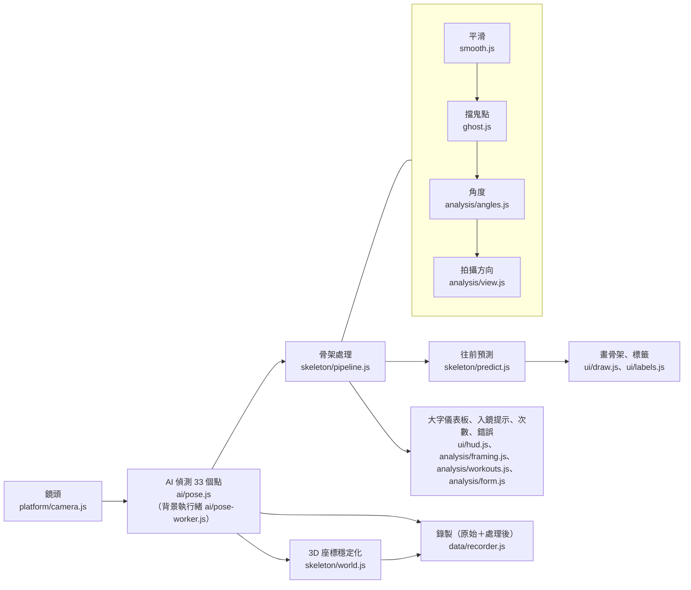

# 程式架構

這份文件說明整個網站的程式怎麼分工：每個資料夾負責什麼、鏡頭的一格畫面會經過哪些程式，以及怎麼測試。第一次看程式碼，建議先讀這份。

## 一、設計原則

1. **影像不離開裝置**：AI 在使用者自己的手機或電腦上執行，鏡頭影像不會上傳。錄製的只有關鍵點座標，而且只會存成使用者自己下載的檔案。雲端（Firebase）只在使用者打開「雲端同步」時存運動總結的數字（`js/cloud/`）。
2. **不需要安裝、不需要編譯**：純 HTML、CSS、JavaScript（ES 模組），直接放在 GitHub Pages 上就能用。沒有打包工具，原始碼就是實際執行的程式。
3. **一個檔案只做一件事**：例如 `smooth.js` 只負責平滑、`angles.js` 只負責算角度。要改某個功能時，只需要看一個檔案。
4. **畫面與計算分開**：計算的程式（`skeleton/`、`analysis/`、`data/`）不碰畫面，可以直接拿來測試，鏡頭頁和重播頁也共用同一份。
5. **原始資料永遠保留**：平滑、擋鬼點都只影響畫面上畫的東西；錄製檔同時存原始資料和處理後的資料，之後換方法時不用重錄。
6. **註解寫原因**：每個檔案開頭說明它的用途，數字門檻旁邊寫「為什麼是這個數字」，以及是用什麼測試、模擬決定的。

## 二、資料夾

```
claude-workspace/
├── index.html          首頁＋鏡頭畫面
├── replay.html         錄製資料重播分析
├── report.html         實測報表（重播分析底下：一次讀很多個實測檔，比對每一組）
├── protractor.html     照片量角器（使用說明「驗證實驗 A」的另一種量法：在照片上拖三個點量角度，和 AI 比）
├── help.html           使用說明
├── sw.js               離線功能（Service Worker；瀏覽器規定要放在網站最外層）
├── firestore.rules     雲端資料庫的安全規則（貼到 Firebase 主控台；docs/firebase-setup.md）
├── firebase.json       Firebase 本機模擬器的設定（開發、測試用）
├── css/
│   ├── style.css       全站共用的樣式（三頁共用的導覽列、首頁、鏡頭畫面、使用說明）
│   └── replay.css      重播分析頁專用的樣式
├── js/
│   ├── config.js       全站設定：MediaPipe 版本、模型位置、網址參數
│   ├── pages/          每一頁的主程式：把下面的模組組合起來、處理按鈕
│   ├── ai/             AI 模型：載入 MediaPipe、在背景執行緒偵測骨架
│   ├── skeleton/       骨架處理：平滑、擋鬼點、往前預測、3D 座標穩定化
│   ├── analysis/       動作判斷：關節角度、拍攝方向、入鏡提示、深蹲次數
│   ├── ui/             畫面元件：骨架、標籤、大字儀表板、數據表、曲線圖
│   ├── platform/       裝置功能：鏡頭、螢幕保持亮著、離線、GPU、裝置支援檢查
│   ├── cloud/          雲端同步（Firebase）：網站只透過這裡用雲端，之後換成自己的伺服器只改這裡
│   └── data/           錄製與重播：匯出 CSV／JSON、讀檔重算、合成示範資料
├── tests/              自動測試（node --test tests/）
├── docs/               文件（這份、資料格式、設計規劃、日後改進）
└── .github/workflows/  自動化：發布網站、每次推送時跑測試
```

### 每個檔案

| 資料夾 | 檔案 | 負責 |
|---|---|---|
| `pages/` | `main.js` | 鏡頭頁：開關鏡頭、每一格的流程、工具列、數據面板、錄製（含倒數）；首頁的卡片各自在 `ui/`（`start-pick.js`、`voice-pick.js`、`cloud-panel.js`、`test-card.js`） |
| | `replay.js` | 重播分析頁：選檔、曲線圖、統計、3D 檢查、匯出角度 CSV |
| | `report.js` | 實測報表頁（10/21）：選很多個實測檔、zip 或這支手機裡的錄製檔，一個一個重算，列出每一組和整體統計、下載 CSV |
| | `protractor.js` | 照片量角器頁（10/22）：選照片、AI 找關節（和鏡頭畫面同一個 AI、同一套角度算法）、拖三個圈量角度、記下來（驗證實驗 A 的清單） |
| | `help.js` | 使用說明頁：「檢查這支手機」 |
| | `hero-art.js` | 首頁的深蹲動畫 |
| | `exercise-demos.js` | 四個動作的示範動畫放到首頁「支援的運動」卡片和鏡頭畫面的「示範」視窗 |
| `ai/` | `pose.js` | 載入 MediaPipe 與模型（兩個下載來源、逾時重試）、選 GPU 或 CPU、背景執行緒當掉時自動重啟 |
| | `pose-worker.js` | 背景執行緒：在這裡跑 AI，主畫面不會卡 |
| | `fps.js` | 計算每秒偵測幾格 |
| | `model-choice.js` | AI 模型的選擇：lite、full 或自動（先用 full，這台裝置跟不上就改用 lite 並記住） |
| | `advisor.js` | 速度建議：量 AI 每格幾毫秒、每秒幾格，建議要不要換每秒格數或模型（只建議，不自動改） |
| `skeleton/` | `pipeline.js` | 處理流程的總管：每一格依序呼叫平滑 → 擋鬼點 → 角度 → 拍攝方向 |
| | `landmarks.js` | 33 個關鍵點的名稱、哪些是主要關節、看不看得到 |
| | `smooth.js` | One Euro Filter 平滑：靜止時不抖、動作快時跟得上 |
| | `ghost.js` | 擋掉 AI 腦補出來的點與「人走了還留著」的鬼骨架 |
| | `predict.js` | 往前預測：補償 AI 計算的時間，骨架不會拖在身體後面 |
| | `world.js` | 3D 座標穩定化：平滑＋骨頭長度限制 |
| `analysis/` | `angles.js` | 關節角度（膝、髖、肘），肢體太短時不給角度 |
| | `view.js` | 判斷側面、斜側面、正面拍，以及面向哪一邊 |
| | `framing.js` | 入鏡提示（請往後退、請站到中間…），不會一直閃 |
| | `light.js` | 光線偵測：畫面平均亮度，太暗時提醒 |
| | `form.js` | 動作錯誤判斷：每個動作常見的錯誤（上身前傾、塌腰…），要標紅的部位 |
| | `session.js` | 運動總結：一次運動做了幾下、品質、錯誤統計，和上一次同一個動作比較；紀錄存在這台裝置上 |
| | `tracker.js` | 一次運動的計算：次數（計時）＋錯誤，並把做每一下期間的錯誤記到那一下；鏡頭畫面和重播分析共用 |
| | `balance.js` | 平衡與重心（10/24）：身體各部位照重量比例算 2D 重心、重心比腳踝往前多少（小腿長為 100%）、站直時前後晃動多少；自由模式、深蹲，側面拍才算；鏡頭畫面和重播分析共用 |
| | `similarity.js` | 動作相似度：每一下的角度曲線和示範動作用 DTW 對齊比對，給 0～100 分 |
| | `calibrate.js` | 個人校正：側身站直不動約 2 秒，記下站直的膝蓋角度和手機傾斜，「站直」門檻和上身前傾的判斷依每個人調整 |
| | `validate.js` | 驗證實驗 A：記下關節角度、和量角器比較的統計（平均誤差、標準差、±5° 以內的比例）、CSV；照片量角器量的也存在這裡（`source: 'photo'`） |
| | `protractor.js` | 照片量角器的計算（10/22）：三個點的角度（2D，和網站一樣）、AI 找到的三個點、存成驗證實驗 A 的一筆（來源寫「照片」） |
| | `reps.js` | 計算次數（伸直 → 彎下去 → 伸直）、計時（姿勢對時計時），四個動作共用 |
| | `workouts.js` | 運動模式：自由、深蹲、伏地挺身、棒式、弓箭步各看哪些角度、門檻多少；使用者選的模式 |
| | `squat.js` | 深蹲的門檻與次數（用 `reps.js`） |
| `ui/` | `draw.js` | 在畫布上畫骨架；做錯的部位畫成粗紅線；重心的記號（黃黑相間的圓、往下到腳底的虛線，重播分析也用） |
| | `labels.js` | 關鍵點的編號標籤、點一下看名稱 |
| | `hud.js` | 站遠也看得到的大字儀表板：左、右兩組照鏡子的方式放在畫面左右兩邊，被擋住的那一組變淡 |
| | `demo.js` | 四個動作的示範動畫（側面火柴人＋角度）和重點字；改重點字只要改這裡 |
| | `sound.js` | 提示音：離開畫面「逼逼逼」、站位不對「逼逼」、站好了「叮」，只在狀況改變時響；音量四段（關、小、中、大），錄製倒數也共用。語音提示選「完整」時改成用講的（`FramingSound` 把提示文字交給 main.js 決定要講還是嗶） |
| | `speech-plan.js` | 說話規則（10/20）：一次一句、過時的不講、先講重要的（站位 ＞ 錯誤 ＞ 次數）、同一種錯誤連續兩下才講（棒式持續 2 秒）、一下做完才講、站位提示唸短句；三種模式（完整、只講錯誤、不講話） |
| | `voice.js` | 講話：用瀏覽器內建的語音發出聲音（音量跟著「音量」按鈕、卡住 15 秒自動清掉）；記住使用者選的語音模式 |
| | `phone-info.js` | 「複製手機資訊」的文字：系統、瀏覽器、螢幕、AI 每格幾毫秒、每秒幾格（實測時記錄各手機的速度） |
| | `copy.js` | 複製文字（不允許直接複製時改成選好的文字框，讓使用者自己長按複製） |
| | `rec-bar.js` | 錄影控制列（10/20，像手機相機）：紅色大圓鈕開始／結束、暫停、倒數設定、「錄製檔 N」；只管畫面（錄製在 main.js） |
| | `library-list.js` | 錄製檔清單的畫面（首頁、鏡頭畫面共用）：勾選、一段一段下載、勾選的一次下載、壓縮成 zip、刪除 |
| | `test-bar.js` | 實測模式的控制列：鏡頭畫面上「這組要做的」按鈕、倒數和錄製中的狀態、「這組做完」、錄過的組打勾（錄製、下載在 main.js） |
| | `infobar-space.js` | 鏡頭畫面左上角的狀態列換行變高時（小手機、點開運算標籤、光線提醒），把下面置中的大字（入鏡提示、紅字、每一下的提示）往下推，不被蓋住 |
| | `start-pick.js` | 首頁「今天要做什麼運動？」：四個大按鈕按了就開鏡頭；`#startBtn`（用目前選的動作開鏡頭）跟著選的動作換位置和字 |
| | `cloud-ask.js` | 第一次有運動總結時問一次要不要打開雲端同步（選過就不再問） |
| | `cloud-panel.js` | 首頁的雲端同步卡片（開關、狀態、刪除雲端上的紀錄）和運動完的詢問；10/22 從 main.js 搬出來 |
| | `voice-pick.js` | 首頁「語音提示」三選一（完整、只講錯誤、不講話）；10/22 從 main.js 搬出來 |
| | `test-card.js` | 首頁「實測模式」卡片：開關、受測者代號、每組做完要不要馬上下載、開著時的黃色提醒；10/22 從 main.js 搬出來 |
| | `task-card.js` | 使用說明的實測任務卡：做完的項目打勾，存在這台裝置上 |
| | `datapanel.js` | 數據面板的數值表格 |
| | `chart.js` | 重播頁的角度曲線圖 |
| `platform/` | `camera.js` | 開關鏡頭、列出鏡頭、判斷前後鏡頭 |
| | `screen.js` | 運動時讓螢幕保持亮著（Wake Lock） |
| | `offline.js` | 註冊離線功能（`sw.js`），`?sw=0` 可移除 |
| | `gpu.js` | 查詢 GPU 名稱 |
| | `support.js` | 這支手機能不能用（WebGL2、相機、系統版本） |
| `cloud/` | `config.js` | Firebase 專案的設定（還沒貼時雲端同步不出現）、Firebase 程式的版本、本機模擬器 |
| | `sync.js` | 上傳哪些欄位（白名單）、每一筆的代號、哪幾筆還沒上傳；和 `firestore.rules` 同一套條件 |
| | `cloud.js` | 載入 Firebase、匿名登入、上傳和補傳、刪除雲端的紀錄、給畫面看的狀態；網站其他地方只用這個檔案 |
| `data/` | `recorder.js` | 錄製：每一格的原始與處理後資料，匯出 CSV、JSON；上限可選 5～20 分鐘 |
| | `test-mode.js` | 實測模式（10/20）：受測者代號、每個動作可以選的組（做對、故意做哪一種錯）、錄製檔裡的實測資訊（`meta.test`）、檔名 `test_A_squat_heel_…` |
| | `library.js` | 錄製檔清單（10/20）：每一段停止後存進這支手機（IndexedDB），列清單、讀檔、標已下載、刪除；讀回來的項目先整理（被改過的不用） |
| | `zip.js` | 把好幾個錄製檔壓縮成一個 zip（瀏覽器內建的壓縮；舊瀏覽器只裝在一起不壓縮） |
| | `unzip.js` | 讀 zip（10/21，實測報表用）：錄製檔清單壓的、Windows／Mac 自己壓的都讀得了；每個位置先檢查、內容用 CRC 核對 |
| | `test-report.js` | 實測報表的比對、加總（10/21）：每一組應該做的（`meta.test`）和網站算的、重錄以最後一次為準、整體統計、CSV |
| | `report-core.js`、`report-worker.js` | 實測報表：一個檔案重算（和重播分析同一套算法），只傳回每一下的錯誤；背景執行緒一次一個檔案 |
| | `replay-core.js` | 重播的計算核心：讀檔、用和鏡頭頁相同的流程重算 |
| | `replay-worker.js` | 重播的背景執行緒 |
| | `synth.js` | 合成示範資料（3D 火柴人做深蹲），測試與示範用 |

## 三、一格畫面的流程

鏡頭每一格畫面，從拍到畫出來會經過這些程式（`pages/main.js` 負責串起來）：



重點：

- **角度、深蹲判斷、錄製都用沒有預測的數字**，預測只影響畫出來的位置。
- **錄製檔保留 AI 的原始輸出**，處理後的資料另外存一份（欄位在後面），格式見 [data-format.md](data-format.md)。
- **重播分析頁**（`data/replay-core.js`）把錄製檔一格一格丟進**同一個** `skeleton/pipeline.js`，結果和當下鏡頭畫面完全相同，所以可以用錄影檢查判斷得對不對。

## 四、執行緒

| 執行緒 | 做什麼 | 為什麼 |
|---|---|---|
| 主畫面 | 按鈕、畫骨架、平滑與判斷（每格約 1 毫秒） | 要碰畫面的工作只能在這裡 |
| AI 背景執行緒（`ai/pose-worker.js`） | 跑 MediaPipe（每格 20～60 毫秒） | 最重的工作移出去，按鈕、動畫不會卡；不支援的瀏覽器自動改在主畫面跑 |
| 重播背景執行緒（`data/replay-worker.js`） | 讀檔（選的檔案直接交給它讀）、重算整段錄影 | 5 分鐘的檔案在手機上要算好幾秒；20 分鐘的檔案超過 100 MB，在主畫面讀會卡住、記憶體多用一份 |
| Service Worker（`sw.js`） | 存 AI 檔案，第二次打開不用下載、沒網路也能用 | 18 MB 的 AI 檔案每次重新下載太慢 |

## 五、怎麼測試

**自動測試**（不需要瀏覽器、不用安裝套件，約 2 秒）：

```
npm test
```

| 檔案 | 測什麼 |
|---|---|
| `tests/skeleton.test.mjs` | 平滑真的變穩、壞掉的數字不會擴散、亂七八糟的輸入不會當掉；3D 座標穩定化更接近真實位置，而且骨頭長度限制比只做平滑更準 |
| `tests/analysis.test.mjs` | 角度計算、深蹲次數與深度、正面拍不計算、小幅晃動不誤算、入鏡提示（蹲低時腳被擋住不叫人往後退） |
| `tests/data.test.mjs` | CSV／JSON 格式、讀 JSON 和讀 CSV 結果相同、壞掉的檔案給中文錯誤、3D 檢查 |
| `tests/platform.test.mjs` | 從瀏覽器識別字串判斷 iPhone、Android、LINE 內建瀏覽器 |
| `tests/safety.test.mjs` | 外部來的資料（網址、錄製檔、這台裝置存的資料）被改過或損壞：`constructor` 這種內建名字不會被當成動作；壞掉的紀錄、記下的角度整理掉；量角器打錯字不算；CSV 不會被 Excel 當成公式；錄製中不能換動作 |
| `tests/properties.test.mjs` | 數字的規則（固定的亂數，每次一樣）：隨機的速度、每秒格數、漏格，做幾下就算幾下、一格最多加 1；棒式秒數只往上加、不比真的撐住的時間多；相似度快慢不扣分、越淺越低；驗證統計和照定義算的一樣；光線、自動調每秒格數、個人校正的門檻都照規則 |
| `tests/cloud.test.mjs` | 雲端同步：上傳的欄位只有白名單、格式不對的不上傳、和 `firestore.rules` 是同一套條件；把 Firebase 換成假的，測補傳、被拒絕時不當成傳過、逾時、上傳中關掉、同時只跑一個、刪除 |
| `tests/rules/rules.test.mjs` | 雲端的安全規則（要開 Firebase 模擬器，指令見 [firebase-setup.md](firebase-setup.md)）：自己的收、別人的和沒登入的擋、被改過的資料每一種都擋、網站算出來的總結一定收 |
| `tests/live/firebase.mjs` | 真的 Firebase 專案（`npm run test:live`，要有網路，GitHub 上不自動跑）：匿名登入、資料庫、發布的安全規則和專案裡的一樣；測試用的帳號和紀錄測完刪掉 |
| `tests/home.test.mjs` | 首頁：四個大按鈕和自由模式的位置、認不得的動作代號當作自由模式；什麼時候問雲端同步、存不了資料時不會一直問；實測任務卡的勾選被改壞時只留卡片上有的項目 |
| `tests/speech.test.mjs` | 說話規則：一次一句、排隊只留一句、過時的不講、先講重要的、錯誤連續兩下才講、棒式持續 2 秒才講、三種模式；語音模式被改壞時用預設；計次準確率（填的字、怎麼算、記到哪一筆）；複製手機資訊的文字 |
| `tests/why.test.mjs` | 錯誤說出原因：每條規則顯示的數字和判斷一致（2,000 組隨機數字）、句子的寫法、每一下記下最嚴重的數字、總結寫出原因、被改過的紀錄不會出錯 |
| `tests/test-mode.test.mjs` | 實測模式：受測者代號只留英文和數字（名字不會進檔名）、每個動作可以選的組和受測者卡一樣、存的設定被改壞、錄製檔裡的實測資訊被改過就當一般檔案、檔名只有英文數字底線、匯出再讀回來還認得 |
| `tests/report.test.mjs` | 實測報表：每一組的次數、抓到、誤報；重錄以最後一次為準；整體統計；CSV 防公式、加引號；讀 zip（壓縮、不壓縮、中文名、壞掉的跳過）；一個實測檔重算（合成資料） |
| `tests/protractor.test.mjs` | 照片量角器：三個點的角度（直角、一直線、重疊、縮放不變）；AI 的點算出來和網站的角度一樣；看不清楚的點不用；存進驗證實驗 A 的清單（來源、統計、CSV 最後一欄）；被改過的來源 |
| `tests/library.test.mjs` | 錄影：暫停中不錄、已錄時間和錄製上限不算暫停、暫停的地方時間空一段（`meta.pauses`）；錄製檔清單被改過的項目整理掉；zip 的檔名、大小、CRC、解壓縮後一樣 |
| `tests/ui.test.mjs` | 大字儀表板：前鏡頭左側那組在畫面左邊、後鏡頭對調；看不到顯示「—」；被擋住的那一側變淡，門檻附近不會一直閃。提示音：還沒走進畫面不響、離開 1 秒後響且最多提醒 3 次、站位提示換來換去至少隔 2 秒、腳被擋住不響。每秒格數：鏡頭兩次叫醒之間送來幾格都算到。示範動畫：最低點的角度符合重點字、骨頭長度不變、不會穿過地面 |

每次推送到 GitHub 時，`.github/workflows/test.yml` 會自動跑一次，結果在 GitHub 的 Actions 頁面。

**測試真的抓得到錯誤嗎？** 我們故意把程式改壞，確認測試會失敗：

| 故意放進去的錯誤 | 測試抓到 |
|---|---|
| 平滑關掉 | ✓ |
| 深蹲「蹲下去」的門檻改錯 | ✓ |
| 匯出的 CSV 少一欄 | ✓ |
| iOS 17.5 被讀成 17.05（以前真的發生過） | ✓ |
| 骨頭長度往反方向修、修正失效 | ✓ |
| 拿掉「深度方向明確才修」（以前試過、比較差的做法） | ✓ |

**瀏覽器端測試**：開發時另外用 Playwright（自動操作瀏覽器的工具）配合假鏡頭，測過開關鏡頭、錄製、匯出、重播、離線、手機版面、背景執行緒當掉恢復等上百種情境。這些測試要先在電腦上準備好 MediaPipe 和瀏覽器才能跑，所以沒有放進專案裡；測過的情境與結果記錄在各 PR 的說明裡。

**真人、真手機的驗證**：見使用說明頁的「驗證實驗」，以及 [roadmap.md](roadmap.md) 的「要等真人、真手機才能確認的事」。

## 六、常見的修改要改哪裡

| 想做的事 | 改哪裡 |
|---|---|
| 換 MediaPipe 版本或模型 | `js/config.js`，以及 `sw.js` 裡的版本號和 `AI_CACHE` 名稱 |
| 調整平滑程度 | `js/skeleton/smooth.js` 開頭的數字（旁邊有每個數字的意思） |
| 多算一個關節角度 | `js/analysis/angles.js` 的 `ANGLES` |
| 新增一種動作（例如伏地挺身） | 仿照 `js/analysis/squat.js` 新增一個檔案，在 `js/pages/main.js` 和 `js/data/replay-core.js` 呼叫 |
| 錄製檔多存一個欄位 | `js/data/recorder.js`（加在最後面，舊的分析程式才不用改），並更新 `docs/data-format.md` |
| 改顏色、版面 | `css/style.css` 最上面的顏色設定（`:root`） |
| 雲端多存一個欄位 | `js/cloud/sync.js` 的 `cloudSession` 和 `firestore.rules` 一起改（欄位意思改了要把格式版本加 1），跑 `npm test` 和 `npm run test:rules` |
| 換掉 Firebase（例如自己的伺服器） | `js/cloud/cloud.js`（見 [firebase-setup.md](firebase-setup.md)「之後換成自己的伺服器」） |

## 七、發布

推送到 `main` 分支後，`.github/workflows/deploy.yml` 會自動發布到 GitHub Pages（約 1 分鐘）。發布時會在每個 JS、CSS 檔名後面加上版本號（例如 `main.js?v=1a2b3c4d`），手機才不會用到「新舊混在一起」的檔案。
